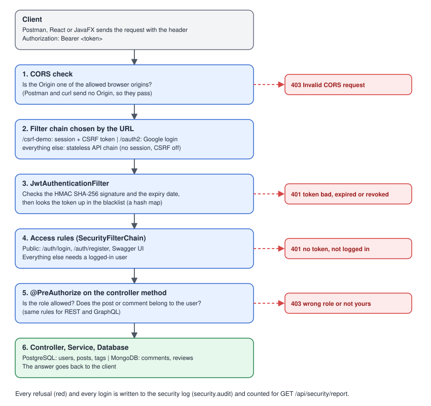
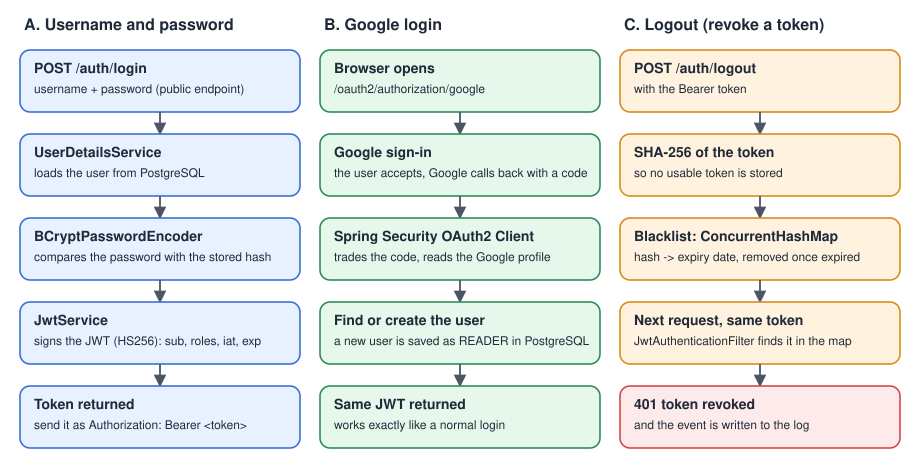

# Blogging Platform IV

A Java 21 / Spring Boot 3.5 blogging backend (REST + GraphQL, PostgreSQL + MongoDB) that is now **secured with Spring Security**:

- log in with **username and password** and get a **JWT**, or log in with **Google**
- three roles, **ADMIN**, **AUTHOR** and **READER**, that decide who can call what
- passwords hashed with **BCrypt**, **CORS** configured, **CSRF** explained and demonstrated
- a **blacklist** for logged-out tokens, and a **security log** with a report

The posts, tags, comments, pagination, transactions and caching come from Lab 3 and are described in [docs/data-layer.md](docs/data-layer.md).

---

## 1. How a request is secured

Every request to the API goes through these layers, in this order. A red box is a refusal.



In plain words:

1. **CORS**: a browser page from an unknown website is refused. Postman and curl are not browsers, so they pass.
2. **Filter chain**: Spring picks the rules by URL. The API (everything except the two special cases below) has **no session and no CSRF**, because the token is sent in a header each time.
3. **JwtAuthenticationFilter** (our own filter): reads `Authorization: Bearer <token>`, checks the signature and the expiry date, and checks that the token was not logged out.
4. **Access rules**: login, registration and Swagger are public. Everything else needs a valid token.
5. **`@PreAuthorize`**: checks the role. `401` means "who are you?", `403` means "you are not allowed".
6. The controller runs.

### Three filter chains (`SecurityConfig`)

| Chain | URLs | Session | CSRF | Why |
|---|---|---|---|---|
| `csrfDemo` | `/csrf-demo/**` | yes | **on** | a form with a cookie, to show how CSRF protection works |
| `googleLogin` | `/oauth2/**`, `/login/oauth2/**` | short | on | the Google login needs a session for a few seconds |
| `api` | everything else | **no** | **off** | stateless JWT |

## 2. How a token is obtained



---

## 3. Quick start

You need JDK 21, PostgreSQL and MongoDB running.

```powershell
createdb -h localhost -p 5433 -U postgres blogging_platform_iv
.\mvnw.cmd spring-boot:run
```

- The first **ADMIN** is created at startup: `admin` / `Admin@12345` (dev profile only).
- The `users` table now has `password` and `role` columns. Use a **new** database (as above) or empty the old one.
- Swagger UI: <http://localhost:8080/swagger-ui/index.html>. Use `POST /auth/login`, copy the token, click **Authorize**, paste it.

### Google login (optional setup)

1. In the [Google Cloud console](https://console.cloud.google.com/apis/credentials) create an **OAuth client ID**, type *Web application*.
2. Add this **authorized redirect URI**: `http://localhost:8080/login/oauth2/code/google`
3. Start the app with the client values:

```powershell
$env:GOOGLE_CLIENT_ID = "<client id>"
$env:GOOGLE_CLIENT_SECRET = "<client secret>"
.\mvnw.cmd spring-boot:run
```

4. Open <http://localhost:8080/oauth2/authorization/google> in a browser and sign in. The page shows a JWT.

Without these two values the app still starts, and only the Google login fails.

---

## 4. Roles

`Role` is a Java enum (`ADMIN`, `AUTHOR`, `READER`) saved as text in the column `users.role`. Each user has one role, and it is copied into the JWT.

| What | ADMIN | AUTHOR | READER | No token |
|---|:-:|:-:|:-:|:-:|
| Register, log in, Swagger | yes | yes | yes | **yes** |
| Read posts, tags, comments, reviews | yes | yes | yes | 401 |
| Add comments and reviews | yes | yes | yes | 401 |
| Create and update posts and tags | yes | yes | 403 | 401 |
| Delete posts and tags | yes | 403 | 403 | 401 |
| Manage users (`/api/users`) | yes | 403 | 403 | 401 |
| Dashboard and security report | yes | 403 | 403 | 401 |

- Registration (`POST /auth/register`) creates a `READER` (or an `AUTHOR` if asked). It refuses `ADMIN`. An admin can create other admins with `POST /api/users`.
- A user who logs in with Google for the first time is saved as `READER` automatically.
- The rule is written above each controller method, for example `@PreAuthorize("hasRole('ADMIN')")`. REST and GraphQL use the same rules.

---

## 5. The features, one by one

### Passwords: BCrypt
`BCryptPasswordEncoder` (bean in `SecurityConfig`) hashes the password in `UserService.create`. The database stores `$2a$10$...`, never the password. At login Spring Security hashes the typed password and compares it with the stored hash.

### JWT login
`POST /auth/login` with `{ "username": "...", "password": "..." }` returns a token. A JWT has three parts: `header.payload.signature`. Paste one into [jwt.io](https://jwt.io) or decode it in Postman:

```json
{ "sub": "jane", "roles": ["AUTHOR"], "iat": 1795084325, "exp": 1795087925, "jti": "dc278bd9-..." }
```

| Claim | Meaning |
|---|---|
| `sub` | the username |
| `roles` | the role |
| `iat` / `exp` | issued at / expires (60 minutes later) |
| `jti` | a unique id for this token |

The signature is an **HMAC SHA-256** of `header.payload` with a secret only the server knows. Anyone can read the payload, but nobody can change it without breaking the signature.

| Token problem | Answer |
|---|---|
| none | `401` Log in first |
| changed (tampered) | `401` The token is not valid |
| expired | `401` The token has expired |
| after logout | `401` The token was revoked |

Code: `JwtService` (create and check), `JwtAuthenticationFilter` (use it on every request), `AuthController` and `AuthService` (login, register, logout).

### Google login (OAuth2)
Spring Security's OAuth2 Client does the Google part (redirect, code exchange, reading the profile). Our part is `OAuth2LoginSuccessHandler`: it takes the verified email and name from Google, finds the user by email or **saves a new one as READER in PostgreSQL**, then returns the **same JWT** as a normal login. Config: `application.properties` (`spring.security.oauth2.client.registration.google...`).

### CORS and CSRF
They protect against different things:

| | CORS | CSRF |
|---|---|---|
| What | A browser rule: a page from site A may not read answers of site B unless B allows it | An attack: site A makes your browser send a request to site B, with your cookie |
| Who checks | the browser, with headers from the server | the server, with a secret token |
| Needed when | a browser app (React, JavaFX) on another origin calls the API | the user is identified by a **cookie** |

**CORS setup** (`SecurityConfig.corsConfigurationSource`): allowed origins `http://localhost:3000` and `http://localhost:5173`, methods `GET POST PUT DELETE OPTIONS`, headers `Authorization Content-Type Accept`. Any other origin gets **403 Invalid CORS request**.

**CSRF**: it is **off for the JWT API**, because there is no cookie to abuse: the token is in the `Authorization` header and a browser never adds that header by itself. It is **on for forms**. Demo at <http://localhost:8080/csrf-demo/form>: the first form has the hidden `_csrf` token and works, the second form has none and gets **403**.

### Data structures and hashing

| Where | What | Why |
|---|---|---|
| Passwords | BCrypt hash | one-way, salted, slow to guess |
| JWT | HMAC SHA-256 signature | detects any change of the token |
| Blacklist key | SHA-256 of the token | no usable token is kept in memory |
| `TokenBlacklist` | `ConcurrentHashMap<hash, expiry>` | logged-out tokens, checked in O(1) with one lookup. Expired entries are removed. |
| `SecurityEvents` | hash maps of counters | events per type, requests per user, failed logins per username and IP |

`POST /auth/logout` puts the token's hash in the blacklist until the token would expire anyway. The map is in memory, so it is empty after a restart (a real deployment would use Redis).

### Security logging and report
`SecurityEvents` writes one line per event on the logger `security.audit`, to the console and to `logs/application.log`:

```
LOGIN_SUCCESS user=admin ip=127.0.0.1
LOGIN_FAILURE user=admin ip=127.0.0.1
BRUTE_FORCE_SUSPECTED key=user:admin failures=5
TOKEN_REJECTED reason="The token has expired. Log in again." ip=127.0.0.1 path=/api/posts
ACCESS_DENIED user=bob path=/api/users
OAUTH_LOGIN user=jane.doe email=jane.doe@gmail.com
```

**Brute force:** 5 failed logins in a row for the same username (or IP) is logged as `BRUTE_FORCE_SUSPECTED`. A successful login resets the count.

**Analyse the log:**

```powershell
Select-String "BRUTE_FORCE_SUSPECTED" logs\application.log
Select-String "LOGIN_FAILURE" logs\application.log | Measure-Object
Select-String "ACCESS_DENIED|UNAUTHENTICATED_REQUEST" logs\application.log
```

**Report:** `GET /api/security/report` (ADMIN only) returns the counters (`events`), the requests per user (token usage and access frequency), and `suspiciousSources`.

---

## 6. Test everything

Import [docs/postman_collection.json](docs/postman_collection.json) and run the **whole collection** (Collection Runner, top to bottom). Every request has a test. Run it on the dev profile.

| Folder | Checks | Requirement |
|---|---|---|
| 0. Authentication | register AUTHOR and READER, ADMIN refused, login, JWT header and claims decoded, wrong password `401` | JWT, BCrypt |
| 1 to 6 | the Lab 3 requests, now sent with the admin token | |
| 7. Role checks | the role table above over REST and GraphQL: `200`, `403`, `FORBIDDEN` | RBAC |
| 8. Token checks | no token, tampered, expired and revoked tokens give `401`; 6 wrong passwords; the security report | JWT, blacklist, logging |
| 9. CORS, CSRF and Google | allowed and unknown origins; form with and without the CSRF token; POST on the API needs no CSRF token; redirect to Google | CORS, CSRF, OAuth2 |
| 10. Cleanup | deletes what the run created | |

The Google login itself needs a browser (step 4 of the Google setup). The collection checks the redirect to Google.

Other ways to try it: **Swagger UI** (secured endpoints have a padlock, `/auth/register` and `/auth/login` have none), **GraphiQL** at <http://localhost:8080/graphiql> (set the header `Authorization: Bearer <token>`, see [docs/examples.graphql](docs/examples.graphql)).

## 7. Settings

| Property | Environment variable | Default |
|---|---|---|
| `app.jwt.secret` (at least 32 characters) | `JWT_SECRET` | fixed value in the dev profile, **required in prod** |
| `app.jwt.expiration-minutes` | | `60` |
| `app.admin.password` | `ADMIN_PASSWORD` | `Admin@12345` in the dev profile, **required in prod** |
| `app.admin.username`, `app.admin.email` | `ADMIN_USERNAME`, `ADMIN_EMAIL` | `admin`, `admin@blog.local` |
| `app.cors.allowed-origins` | `CORS_ALLOWED_ORIGINS` | `http://localhost:3000,http://localhost:5173` |
| Google client | `GOOGLE_CLIENT_ID`, `GOOGLE_CLIENT_SECRET` | placeholders |

The dev secret and the dev admin password are in this public repository: use them locally only.

## 8. Where each requirement is implemented

| Requirement | Where |
|---|---|
| Spring Security, custom filters, `SecurityFilterChain` | `security/SecurityConfig`, `security/JwtAuthenticationFilter` |
| BCrypt | `SecurityConfig.passwordEncoder`, `UserService.create` |
| JWT login, token claims, validation, `401` | `AuthController`, `AuthService`, `JwtService`, `JsonSecurityHandlers` |
| Google OAuth2, user saved, role assigned | `SecurityConfig.googleLogin`, `OAuth2LoginSuccessHandler`, `UserService.findOrCreateGoogleUser` |
| Roles and `@PreAuthorize` | `entity/Role`, all classes in `controller/` |
| CORS | `SecurityConfig.corsConfigurationSource` |
| CSRF explanation and demo | `SecurityConfig.csrfDemo`, `CsrfDemoController`, section 5 |
| Hashing, blacklist, lookup maps | `TokenBlacklist`, `SecurityEvents`, section 5 |
| Security logging and reports | `SecurityEvents`, `SecurityReportController` |
| OpenAPI with secured and public endpoints | `OpenApiConfig` (bearer scheme), `@SecurityRequirements` on the public endpoints |
| Postman tests | `docs/postman_collection.json` |

## 9. Known limits

- The role decides what a user may do, but there is **no ownership check**: an AUTHOR can pass any `authorId` when creating a post (as in Lab 3).
- A token stays valid until it expires, even if the user is deleted or changes role, unless the user logs out.
- One role per user. The blacklist and counters are in memory.
- The server speaks plain HTTP. In production use HTTPS, because a Bearer token sent over HTTP can be read.
